  

  

  

  

  

## Locked In Rn

  

  

## 🚩 CTF Arena

<table>
  <tr>
    <td width="50%" valign="top">

### 🏴 Team localhost969
Our CTF team and its portfolio: writeups, achievements and the crew.

    </td>
    <td width="50%" valign="top">

### 📊 CTFtime
Tracking the team's results and rankings on the global CTF scoreboard.

    </td>
  </tr>
</table>

  
  
  
  
  
  

## 🛠️ Languages & Tools

<h3 align="center">Programming Languages</h3>

  &nbsp;&nbsp;
  &nbsp;&nbsp;
  &nbsp;&nbsp;
  

<h3 align="center">Frontend</h3>

  &nbsp;&nbsp;
  &nbsp;&nbsp;
  &nbsp;&nbsp;
  &nbsp;&nbsp;
  

<h3 align="center">Backend & Database</h3>

  &nbsp;&nbsp;
  &nbsp;&nbsp;
  &nbsp;&nbsp;
  

<h3 align="center">Security & Tools</h3>

  

  

  

## 🔗 Connect with Me

  &nbsp;&nbsp;
  &nbsp;&nbsp;
  &nbsp;&nbsp;
  

  
  
  

  

  

